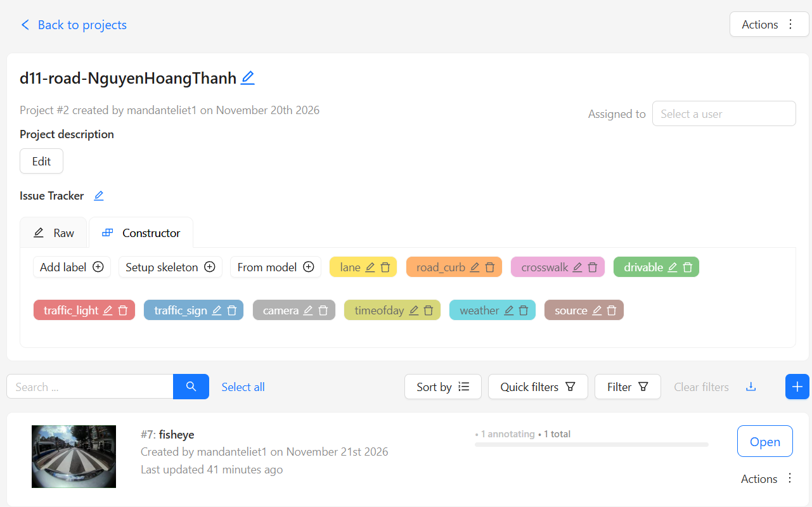
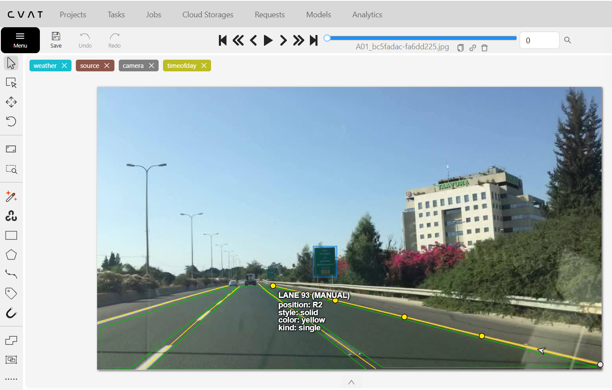
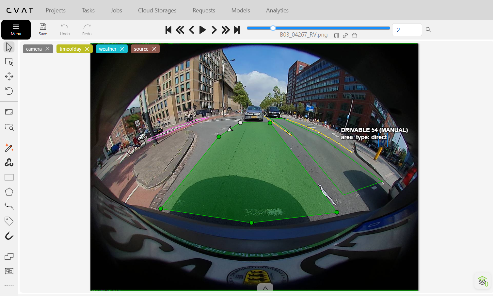

# Báo cáo cá nhân — Ngày 11

Họ tên: Nguyễn Hoàng Thành  
Mã học viên: 2A202603296  
Phiên bản CVAT (Help → About): 2.81.0  
Guideline: Road v1.0  
Lần nộp (`revision` trong manifest): **Chưa có manifest trong thư mục `lab/`; cần điền theo manifest đã nộp.**  
Thời điểm export (ngày giờ trên CVAT): 10:50 AM 21/11/2026  
Số lần nộp lại sau Rework: 1

## 1. Kiểm project

Đối chiếu cấu trúc export CVAT for images 1.1 với taxonomy Road v1.0:

| Mục | Đúng như guideline Road v1.0? | Ghi chú |
| --- | --- | --- |
| 6 label, đúng kiểu | Có | Export có lane (polyline), road_curb (polyline), crosswalk (polygon), drivable (polygon), traffic_light (rectangle), traffic_sign (rectangle). |
| Thuộc tính và giá trị | Có | Export có cấu hình thuộc tính cho các label theo taxonomy Road v1.0. |
| 4 tag ảnh | Có | Kiểm tra được tag `camera`, `timeofday`, `weather`, `source` trên ảnh; giá trị camera khớp camera front/fisheye theo tên ảnh. |

Cách kết thúc polyline trên bản CVAT này: Kết thúc tại điểm đối tượng bị khuất hoặc hết nhìn thấy; giữ polyline theo chiều gần xe ra xa.  
Cách đặt tag ảnh trên bản CVAT này: Mỗi ảnh có bốn tag `camera`, `timeofday`, `weather`, `source`, mỗi tag dùng thuộc tính `value`.

## 2. Số lượng đã gán

| Task | Ảnh | lane | road_curb | crosswalk | drivable | traffic_light | traffic_sign |
| --- | ---: | ---: | ---: | ---: | ---: | ---: | ---: |
| front | 12 | 29 | 11 | 10 | 26 | 25 | 12 |
| front-extra (đã làm 4 / 4) | 4 | 8 | 0 | 3 | 8 | 3 | 3 |
| fisheye | 8 | 2 | 0 | 12 | 9 | 1 | 2 |
| fisheye-extra (đã làm 4 / 4) | 4 | 0 | 0 | 4 | 6 | 0 | 1 |

## 3. Bảng ca khó

| Ảnh | Nhãn | Phân vân giữa | Đã chọn | Lý do |
| --- | --- | --- | --- | --- |

## 4. Phiếu QC 1 nhận được

| Mã lỗi | Số lỗi | Đồng ý? | Đã sửa? |
| --- | ---: | --- | --- |

## 5. Kiểm file export

| File | Mở lại được? | Số shape ảnh 1 (job / file) | Số shape ảnh 2 (job / file) | Tag camera có trong XML? |
| --- | --- | --- | --- | --- |
| `NguyenHoangThanh-front.zip` | Có | A01: 8 / 8 | A02: 6 / 6 | Có (`front`) |
| `NguyenHoangThanh-fisheye.zip` | Có | B01: 2 / 2 | B02: 3 / 3 | Có (`fisheye_front`) |

## 6. Ảnh chụp màn hình

1. Tab Labels của project.

2. Một ảnh camera trước đã gán đủ (làn, vùng lái, đèn/biển).

3. Một ảnh fisheye đã gán, phóng to đoạn polyline cong.

4. Một đoạn XML có `<polyline label="lane">`.
<polyline label="lane" source="manual" occluded="0" points="916.45,668.89;817.39,593.42;663.31,470.79;635.80,443.27;625.58,427.55;620.07,418.11;615.36,393.74" z_order="0">
<attribute name="position">R1</attribute>
<attribute name="style">dashed</attribute>
<attribute name="color">white</attribute>
<attribute name="kind">single</attribute>
</polyline>

## 7. Tự đánh giá

Lỗi bạn mắc nhiều nhất hôm nay (theo mã QC1-xx), và cách tránh ở Ngày 20: **Phiếu đó chưa có trong các file được cung cấp.**  
Nhãn của bạn đi vào model ở đâu? Chọn một lỗi đã sửa và nói nó làm model học sai thế nào: **Chưa có phiếu QC của lô bạn để xác định lỗi.**

## 8. (Tùy chọn, buffer) Từ polyline đến đích row-anchor

| y | 720 | 680 | 640 | 600 | 560 |
| --- | ---: | ---: | ---: | ---: | ---: |
| x của chúng tôi |  |  |  |  |  |
| x của bạn kia |  |  |  |  |  |

Trả lời 3 câu:

1. Năm số x đó chính là đích mà một model row-anchor học cho vạch này. Nếu bạn dừng polyline sớm 40 px, hàng nào đổi thành "không có làn"?
2. So với bạn được kiểm (cùng ảnh): ở hàng 720 và hàng 560, hai bạn lệch nhau bao nhiêu pixel? Lệch ở hàng nào ảnh hưởng LKA nhiều hơn (slide 25)?
3. Nếu polyline vẽ từ xa về gần (ngược quy tắc 2), cách tính trên có đổi không? Script nào sẽ gặp khó?

